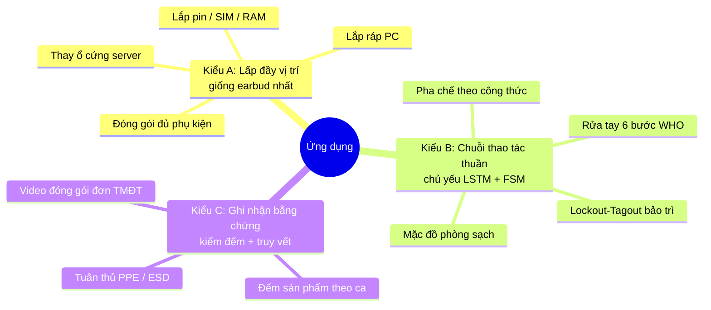

# Danh mục dự án thiết thực có thể xây trên khung hiện tại (không giới hạn AOI)

> Bổ sung cho [DE_XUAT_MO_RONG_UNG_DUNG_LAP_RAP.md](DE_XUAT_MO_RONG_UNG_DUNG_LAP_RAP.md). Tài liệu đó tập trung vào AOI-lite; tài liệu này mở rộng sang mọi bài toán "camera + thao tác + thứ tự".

## 1. Bộ lọc: bài toán nào hợp với khung này?

Khung hiện tại mạnh nhất khi bài toán có **đủ 3 yếu tố**:

1. **Vật thể có trạng thái nhìn thấy được** (trống/đầy, mở/đóng, có/không) → YOLO
2. **Động tác của tay lặp lại, phân biệt được** → DINOv2 + BiLSTM
3. **Thứ tự bắt buộc, sai thứ tự gây hậu quả** → FSM

Nếu chỉ có (1) thì dùng YOLO là đủ, không cần cả khung. Nếu chỉ có (2) + (3) (không có vật thể rõ ràng) thì vẫn làm được, chỉ cần bỏ phần Fusion hình học.

Theo đó, mình chia các dự án thành 3 kiểu:

---

## 2. Kiểu A — Lấp đầy vị trí (tái sử dụng `slot_fusion` nhiều nhất)

### A1. Lắp ráp PC / mainboard ⭐ *(rất hợp với sinh viên IT)*

**Thực tế:** cửa hàng lắp PC, bộ phận IT doanh nghiệp, dây chuyền lắp máy tính đồng bộ. Lỗi thường gặp: RAM cắm sai khe (không chạy dual-channel), quên bóc nilon tản nhiệt, quên cắm dây nguồn CPU 8-pin, CPU đặt lệch chiều tam giác.

| Thành phần | Nội dung |
|---|---|
| YOLO | `ram_slot_empty`, `ram_inserted`, `m2_slot_empty`, `m2_ssd`, `cpu_socket_open`, `cpu_seated`, `cooler_mounted`, `power_8pin_connected` |
| LSTM | `insert_ram`, `insert_ssd`, `mount_cooler`, `plug_cable`, `idle` |
| FSM | đặt CPU → khóa socket → tra keo → lắp tản → RAM khe A2/B2 → SSD → dây nguồn |
| Vi phạm | RAM ở A1/B1 khi chỉ có 2 thanh; lắp tản khi chưa khóa socket; xác nhận xong khi chưa cắm 8-pin |

**Vì sao nên chọn:** đồ dùng sẵn có (mainboard cũ đủ dùng); đúng chuyên ngành, dễ giải thích; cấu trúc "N khe + đúng khe" giống hệt `earbud_slot_pairs` (`left_earbud → empty_left` ⇔ `ram → slot_A2`).

### A2. Đóng gói đủ phụ kiện (kitting)

Hộp N ngăn: máy + sạc + cáp + sách + tem. Thiếu phụ kiện → khách khiếu nại. Gần như copy bản earbud, chỉ tăng số khe. **1–2 tuần.**

### A3. Thay ổ cứng / module trong rack server

Kỹ thuật viên data center thay ổ hỏng: phải rút đúng bay đang báo đèn đỏ. Rút nhầm ổ đang chạy trong RAID có thể gây mất dữ liệu.
- YOLO: `drive_bay_led_fault`, `drive_bay_empty`, `drive_inserted`.
- FSM: chỉ được rút bay đang báo lỗi → lắp ổ mới vào **đúng bay đó**.
- Hướng an ninh: ghi log ai thao tác bay nào lúc nào (audit trail thao tác vật lý), hợp với định hướng Security Auditor.

---

## 3. Kiểu B — Chuỗi thao tác thuần (LSTM + FSM là chính)

### B1. Rửa tay đúng 6 bước WHO ⭐

**Thực tế:** bệnh viện, nhà máy thực phẩm, bếp công nghiệp, phòng sạch. Đây là quy định bắt buộc nhưng gần như không ai kiểm tra được.
- LSTM: 6 động tác WHO (`palm_to_palm`, `back_of_hands`, `interlaced_fingers`, `backs_of_fingers`, `thumbs`, `fingertips`) + `idle`.
- FSM + temporal evidence: mỗi bước phải đủ **thời lượng tối thiểu** (vd. ≥ 3 giây). `TemporalEvidenceAccumulator` đang làm đúng việc này.
- YOLO gần như không cần (chỉ phát hiện tay trong vùng bồn rửa).
- **Ưu điểm lớn:** có dataset công khai trên Kaggle để bắt đầu, không cần quay từ đầu.

### B2. Lockout–Tagout (LOTO) trước khi bảo trì máy

Quy trình an toàn bắt buộc: tắt máy → ngắt CB → gắn khóa → treo thẻ → thử khởi động để xác nhận đã ngắt điện → mới được mở máy. Bỏ bước có thể gây tai nạn chết người.
- YOLO: `breaker_on/off`, `lock_attached`, `tag_attached`, `panel_open`.
- FSM: `panel_open` trước `lock_attached` → VIOLATION nghiêm trọng.
- Đây là kiểm soát tuân thủ quy trình, cùng tư duy với audit bảo mật.

### B3. Mặc đồ phòng sạch (gowning)

Thứ tự: bao giày → mũ trùm → áo liền quần → khẩu trang → găng tay. Sai thứ tự làm nhiễm bẩn phòng sạch. Áp dụng ở nhà máy bán dẫn, dược phẩm.

### B4. Pha chế theo công thức (F&B)

Chuỗi trà sữa/cà phê: đúng nguyên liệu, đúng thứ tự, đủ số lần định lượng. YOLO nhận chai siro/topping, LSTM nhận `pour`, `shake`, `scoop`. Giá trị: đồng đều chất lượng giữa các chi nhánh và đào tạo nhân viên mới.

---

## 4. Kiểu C — Ghi nhận bằng chứng / truy vết

### C1. Video bằng chứng đóng gói đơn TMĐT ⭐ *(giá trị kinh doanh rõ nhất ở VN)*

**Thực tế:** shop bán hàng trên các sàn TMĐT đang phải **quay tay** video đóng gói để làm bằng chứng khi khách khiếu nại "thiếu hàng/sai hàng". Họ phải tự tìm lại đoạn video, mất nhiều thời gian.
- Quét mã vận đơn (QR/barcode, `cv2.QRCodeDetector` / `pyzbar`) → tự mở phiên mới mang mã đơn.
- YOLO đếm sản phẩm bỏ vào hộp; LSTM nhận `place_item`, `seal_box`.
- FSM: quét mã → bỏ hàng → dán băng keo; dán khi chưa có hàng → cảnh báo.
- Đầu ra: **tự cắt clip theo mã đơn** + log JSONL (đã có `event_log`), tra cứu bằng mã đơn.
- **Bảo mật/toàn vẹn bằng chứng:** băm SHA-256 mỗi clip và ghi vào log (giống `holdout.py`) để chứng minh video không bị chỉnh sửa. Đây là điểm cộng riêng cho định hướng Security Auditor.

### C2. Kiểm đếm sản lượng theo ca

Đếm số chu trình hoàn tất (`S4_COMPLETED`) và thời gian chu kỳ (cycle time) mỗi sản phẩm, phát hiện điểm nghẽn. Tận dụng ngay event log hiện có, có thể làm như một tính năng phụ của mọi dự án trên.

### C3. Tuân thủ PPE / ESD

Kiểm tra công nhân đeo vòng ESD, găng tay chống tĩnh điện trước khi chạm vào bo mạch. Không có thứ tự rõ ràng nên FSM ít vai trò; thuần YOLO (có sẵn nhiều dataset PPE). Kém tận dụng khung hơn, chỉ nên làm như module phụ.

---

## 5. So sánh và khuyến nghị

| Dự án | Giá trị thực tế | Tái sử dụng khung | Dữ liệu dễ lấy | Thời gian | Điểm nhấn |
|---|---|---|---|---|---|
| **A1 Lắp ráp PC** | ★★★ | ★★★ | ★★★ | 3–4 tuần | Đúng ngành IT |
| A2 Đóng gói phụ kiện | ★★ | ★★★ | ★★★ | 1–2 tuần | Nhanh nhất |
| A3 Thay ổ server | ★★ | ★★★ | ★ | 3–4 tuần | Audit trail |
| **B1 Rửa tay WHO** | ★★★ | ★★ | ★★★ (Kaggle) | 2–3 tuần | Có dataset sẵn |
| B2 LOTO | ★★★ | ★★ | ★★ | 3–4 tuần | An toàn tính mạng |
| B3 Phòng sạch | ★★ | ★★ | ★ | 3 tuần | Ngành bán dẫn |
| B4 Pha chế | ★★ | ★★ | ★★ | 3 tuần | F&B chuỗi |
| **C1 Đóng gói TMĐT** | ★★★ | ★★ | ★★★ | 3–4 tuần | Có người dùng thật ngay |
| C2 Kiểm đếm ca | ★★ | ★★★ | ★★★ | 1 tuần | Tính năng phụ |
| C3 PPE/ESD | ★★ | ★ | ★★★ | 2 tuần | Module phụ |

**Top 3 đề xuất:**

1. **A1 – Lắp ráp PC:** demo kỹ thuật, chứng minh khung tổng quát được (cùng cấu trúc slot với earbud nhưng nhiều khe, nhiều bước hơn).
2. **C1 – Đóng gói đơn TMĐT:** demo giá trị kinh doanh, bài toán thị trường đang tự giải bằng tay.
3. **B1 – Rửa tay WHO:** demo phần LSTM + temporal evidence mạnh nhất, có dataset công khai nên bắt đầu được ngay.

Ba dự án này phủ đủ 3 kiểu A/B/C, cho thấy khung không bị bó vào một loại bài toán.

## 6. Cần viết mới gì cho mỗi kiểu

| Kiểu | Detector | Action model | Fusion | FSM |
|---|---|---|---|---|
| A | Train lại lớp mới | Train lại | Tổng quát `PairedEarbudFusionEngine` → `SlotFusionEngine` N khe | JSON |
| B | Tối giản (chỉ "tay trong vùng") | Train lại, là phần chính | Fusion nhẹ: action + thời lượng tối thiểu | JSON |
| C | Train lại + đọc QR/barcode | Train lại | Fusion đếm + quản lý phiên theo mã | JSON + cắt clip |

Việc nên làm trước tiên là tách `PairedEarbudFusionEngine` (đang khóa cứng `required_earbuds == 2`) thành `SlotFusionEngine` tổng quát N khe. Bước này mở khóa toàn bộ kiểu A và một phần kiểu C.
