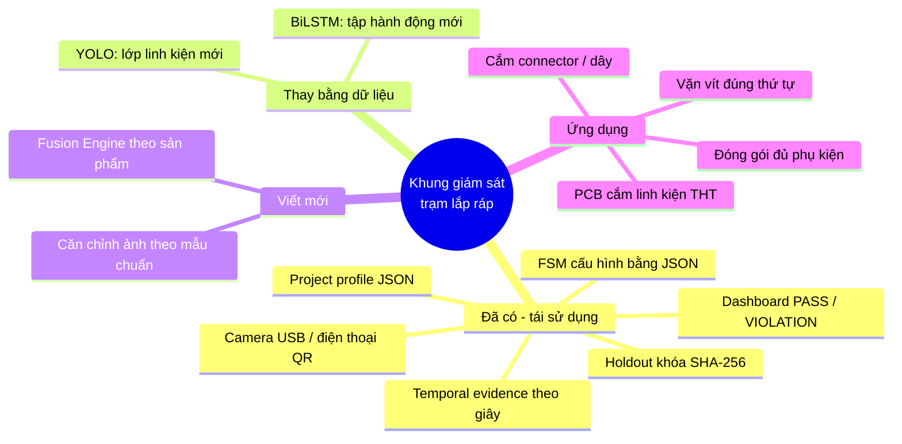

# Đề xuất mở rộng: từ lắp tai nghe sang các bài toán lắp ráp công nghiệp

> Mục tiêu tài liệu: cho thấy pipeline hiện tại (YOLO + DINOv2/BiLSTM + Fusion + FSM) **không phải demo riêng cho tai nghe**, mà là một *khung giám sát trạm lắp ráp thủ công* có thể đổi sang sản phẩm khác chủ yếu bằng **dữ liệu + file cấu hình**, chỉ viết mới phần Fusion.

---

## 1. Ý tưởng cốt lõi (giải thích kiểu Feynman)

Hãy tưởng tượng một tổ trưởng chuyền đứng sau lưng công nhân. Họ làm 3 việc:

1. **Nhìn đồ vật** — "linh kiện này đã nằm đúng chỗ chưa, đúng chiều chưa?" → đây là việc của **YOLO** (vật gì, ở đâu).
2. **Nhìn động tác** — "người này vừa cắm linh kiện, hay chỉ đưa tay qua?" → việc của **DINOv2 + BiLSTM** (hành động theo thời gian).
3. **Nhớ quy trình** — "bước 3 chưa xong mà đã sang bước 4 → sai" → việc của **FSM**.

**Fusion** là chỗ tổ trưởng *kết hợp* 1 và 2: chỉ công nhận "đã lắp" khi **vừa thấy động tác lắp, vừa thấy trạng thái vật lý thay đổi** (khe trống biến mất, linh kiện xuất hiện đúng vị trí).

Tai nghe chỉ là một trường hợp: 1 hộp, 2 khe, 4 bước. Bất kỳ trạm lắp ráp nào có cấu trúc **"N vị trí cần lấp đầy + thứ tự thao tác + lỗi sai vị trí/sai chiều"** đều dùng lại được khung này.



---

## 2. Những gì repo đã "generic" sẵn

| Thành phần | File | Muốn đổi sản phẩm thì làm gì |
|---|---|---|
| Project profile | `configs/projects/*.json` | Tạo profile mới trỏ tới camera/FSM/action config + fusion factory |
| FSM | `src/assembly/fsm.py` (`ConfigurableAssemblyTracker`) | **Chỉ viết JSON** state/allowed/violations, không sửa code |
| Action model | `configs/action_*.json`, `scripts/train_action_model.py` | Đổi danh sách `actions`, gán nhãn video mới, train lại |
| Detector | `configs/camera_*.json`, `scripts/train_detector.py` | Đổi `classes`, gán nhãn ảnh mới, train lại |
| Fusion | `fusion.factory = "module:Class"` trong profile | Viết class mới có `reset()`, `update()`, `status_text()` |
| Temporal evidence | `src/assembly/temporal_evidence.py` | Tái sử dụng nguyên (xác nhận theo thời gian tích lũy, không theo số frame) |
| Camera, UI, QR điện thoại, holdout | `camera_input.py`, `hybrid_dashboard.py`, `phone_camera.py`, `holdout.py` | Tái sử dụng nguyên |

Điểm "bán" được với công ty: **cơ chế plugin `fusion.factory` + FSM bằng JSON** nghĩa là kỹ sư quy trình (không phải lập trình viên) có thể tự định nghĩa quy trình mới.

---

## 3. AOI là gì — và hệ thống này đứng ở đâu so với AOI

**AOI (Automated Optical Inspection)** là máy chụp ảnh bo mạch (PCB) sau công đoạn SMT/reflow hoặc sau cắm linh kiện, rồi so với **mẫu chuẩn (golden board)** để tìm lỗi:

- **Missing** – thiếu linh kiện
- **Wrong part** – sai linh kiện (điện trở sai giá trị, IC sai mã)
- **Polarity / Orientation** – ngược chiều (tụ hóa, diode, LED, IC chấm số 1)
- **Offset / Skew** – lệch vị trí, xoay lệch
- **Solder defects** – thiếu thiếc, cầu thiếc (bridge), tombstone (linh kiện dựng đứng)

AOI thương mại (Koh Young, Omron, Saki, Mirtec…) dùng camera công nghiệp độ phân giải cao, **đèn chiếu sáng có kiểm soát** (đèn vòm RGB, ánh sáng đồng trục), thậm chí đo 3D chiều cao mối hàn. Camera 2D + webcam **không thay thế được** loại máy đó cho linh kiện SMD nhỏ (0402, 0201) hay kiểm tra mối hàn.

**Nhưng có một khoảng trống mà AOI không làm:** AOI chỉ nhìn *kết quả cuối* (ảnh tĩnh). Hệ thống của mình nhìn *quá trình* (video + hành động + thứ tự). Vì vậy định vị đúng là:

| | AOI truyền thống | Hệ thống này (đề xuất) |
|---|---|---|
| Thời điểm | Sau công đoạn, máy riêng | **Ngay tại trạm thủ công**, trong lúc làm |
| Đầu vào | Ảnh tĩnh, đèn chuẩn | Video, ánh sáng xưởng bình thường |
| Phát hiện | Lỗi trên sản phẩm | Lỗi sản phẩm **+ lỗi thao tác/thứ tự** |
| Phản hồi | Báo NG, sản phẩm đã sai → rework | Cảnh báo **trước khi sang bước tiếp** → không tạo ra lỗi |
| Chi phí | Hàng trăm triệu – tỷ đồng | Webcam/điện thoại + PC |

→ Cách nói với công ty: **"AOI-lite tại trạm cắm linh kiện thủ công (manual insertion), kết hợp poka-yoke quy trình"** — bổ sung cho AOI, không cạnh tranh với AOI.

---

## 4. Các dự án đề xuất (xếp theo mức độ nên làm)

### ⭐ Đề xuất 1 — Kiểm tra cắm linh kiện xuyên lỗ (THT) trên PCB *(nên chọn làm demo chính)*

**Bối cảnh thật:** Ở các nhà máy điện tử (bộ nguồn, mạch điều khiển, thiết bị gia dụng), linh kiện xuyên lỗ như tụ hóa, relay, connector, biến áp, LED vẫn được **công nhân cắm tay** trước khi qua hàn sóng (wave soldering). Lỗi ngược cực tụ/diode ở đây → sau hàn sóng mới phát hiện → tốn rework, có thể nổ tụ.

**Quy trình mẫu:**
```text
đặt PCB vào jig → cắm R1..R4 → cắm tụ C1, C2 (đúng cực) → cắm LED D1 (đúng chiều) → cắm IC U1 (đúng chấm số 1) → xác nhận hoàn tất
```

**Ánh xạ sang kiến trúc hiện tại:**

| Earbud hiện tại | PCB THT |
|---|---|
| `open_case` (hộp mở) | `pcb_in_fixture` (bo đã đặt vào jig) |
| `empty_left`, `empty_right` (khe trống) | `empty_pad_C1`, `empty_pad_D1`… hoặc 1 lớp `empty_footprint` + tọa độ từ golden layout |
| `left_earbud`, `right_earbud` | `cap_ok`, `cap_reversed`, `led_ok`, `led_reversed`, `ic_ok`, `ic_rotated`, `resistor` |
| `wrong_earbud_side` | `wrong_polarity`, `wrong_footprint` |
| `insert_earbud` (LSTM) | `insert_component` (LSTM, 1 hành động chung — đúng như nhánh 4 lớp) |
| 2 khe, đếm 0/1/2 | N footprint, đếm 0..N |

**Phần kỹ thuật cần thêm (đây cũng là phần "ăn điểm"):**

1. **Căn chỉnh theo golden board (homography):** dán 4 marker ArUco ở góc jig → mỗi frame tính ma trận biến đổi phối cảnh → biết chính xác pixel nào là footprint C1. Nhờ vậy *không cần* YOLO tự học vị trí khe; YOLO chỉ cần trả lời "ở ô này có tụ không, chiều nào".
2. **Phân loại cực tính bằng crop:** cắt vùng quanh mỗi footprint (đã căn chỉnh) → classifier nhỏ `ok / reversed / missing`. Tụ hóa có vạch trắng phía cực âm, LED có chân dài/mép phẳng, IC có chấm → đặc trưng hình học rõ, dễ học.
3. **Anomaly detection cho lỗi lạ:** lỗi thật rất hiếm, khó thu đủ dữ liệu. Dùng phương pháp *chỉ học trên mẫu tốt* (PatchCore / PaDiM trong thư viện `anomalib`): mô hình học "bo tốt trông như thế nào", vùng nào khác thường → cảnh báo. Có thể tái sử dụng chính embedding DINOv2 đang có.
4. **Fusion mới `FootprintFusionEngine`:** tổng quát hóa `PairedEarbudFusionEngine` từ 2 cặp cố định sang N footprint, mỗi footprint có `expected_class` và `polarity_required`.

**Vật tư demo:** 2–3 bộ kit hàn mạch tập (mạch nháy LED, mạch khuếch đại) loại vài chục nghìn đồng, chỉ cắm *không hàn* → tháo ra cắm lại được vô hạn lần để quay dữ liệu, kể cả cố tình cắm ngược để tạo mẫu lỗi.

**Vì sao nên chọn:** đúng từ khóa AOI mà công ty quan tâm; lỗi có hậu quả thật (ngược cực = hỏng/nổ); dữ liệu rẻ; thể hiện được cả 3 tầng (vật thể + hành động + quy trình).

---

### Đề xuất 2 — Vặn vít đúng số lượng và đúng thứ tự (screw-tightening poka-yoke)

**Bối cảnh:** Lắp vỏ thiết bị, tấm tản nhiệt, motor… thường yêu cầu vặn vít theo **thứ tự chéo** (1-3-2-4) để phân bố lực đều; quên 1 vít là lỗi rất phổ biến. Nhiều xưởng đang dùng tô vít điện có đếm số lần, nhưng không biết *vít nào* đã vặn.

- **YOLO:** `screw_hole_empty`, `screw_seated`, `screwdriver_tip`.
- **LSTM:** `pick_screw`, `drive_screw`, `idle`.
- **Fusion:** gán mỗi lần `drive_screw` cho lỗ gần đầu tô vít nhất; xác nhận khi lỗ đó chuyển `empty → seated`.
- **FSM:** thứ tự 1→3→2→4; vặn 2 trước 3 → `VIOLATION: sai thứ tự siết`.
- **Độ khó:** trung bình. FSM gần như copy cấu trúc earbud. Thử thách: đầu vít nhỏ, cần camera gần.

---

### Đề xuất 3 — Cắm connector / bó dây (wire harness, FPC)

**Bối cảnh:** Cắm cáp FPC/FFC vào connector rồi **đóng lẫy khóa (latch)**; cắm bó dây vào đúng cổng theo màu. Lỗi "cắm nửa chừng" hoặc "quên đóng lẫy" gây lỗi chập chờn rất khó tìm.

- **YOLO:** `connector_open_latch`, `connector_closed_latch`, `cable_inserted`, dây theo màu.
- **LSTM:** `insert_cable`, `close_latch`.
- **FSM:** cắm cáp → đóng lẫy; đóng lẫy khi chưa có cáp → vi phạm; cáp màu đỏ vào cổng của màu xanh → `wrong_port` (giống `wrong_earbud_side`).
- **Giới hạn trung thực:** camera không xác nhận được cáp đã cắm *đủ sâu* nếu khác biệt chỉ vài mm — cần góc nhìn nghiêng hoặc vạch đánh dấu trên cáp.

---

### Đề xuất 4 — Đóng gói đủ phụ kiện (kitting / packing verification) *(quick win, 1–2 tuần)*

**Bối cảnh:** Đóng hộp sản phẩm: máy + sạc + cáp + sách hướng dẫn + tem bảo hành. Thiếu phụ kiện → khiếu nại khách hàng.

- **Gần như giống hệt earbud:** hộp có N ngăn (khe), mỗi ngăn một loại phụ kiện, cuối cùng đóng nắp.
- Tái sử dụng `slot_fusion` gần nguyên vẹn, chỉ nâng số khe từ 2 lên N.
- **Dùng làm gì:** chứng minh *nhanh* rằng đổi sản phẩm chỉ tốn công gán nhãn + config, trước khi đầu tư vào đề xuất 1.

---

### So sánh nhanh

| Tiêu chí | 1. PCB THT (AOI-lite) | 2. Vặn vít | 3. Connector | 4. Đóng gói |
|---|---|---|---|---|
| Liên quan AOI | ★★★ | ★ | ★★ | ★ |
| Giá trị thực tế cho nhà máy | ★★★ | ★★★ | ★★★ | ★★ |
| Tái sử dụng code hiện có | ★★ | ★★★ | ★★ | ★★★ |
| Chi phí vật tư demo | Rất thấp | Thấp | Thấp | Rất thấp |
| Độ khó kỹ thuật | Trung bình–cao | Trung bình | Trung bình | Thấp |
| Thời gian ước lượng (1 người) | 4–6 tuần | 3–4 tuần | 3–4 tuần | 1–2 tuần |

**Lộ trình khuyến nghị:** làm **Đề xuất 4** trước (chứng minh khả năng tổng quát hóa) → chuyển sang **Đề xuất 1** làm demo chính để trình bày với công ty.

---

## 5. Bản phác thảo cấu hình cho Đề xuất 1

Dưới đây là *bản nháp minh họa* (chưa đưa vào `configs/` vì chưa có checkpoint và Fusion class tương ứng — runtime sẽ từ chối chạy nếu thiếu).

**Project profile** `configs/projects/pcb_tht.json`:
```json
{
  "schema_version": 1,
  "name": "pcb_tht_v1",
  "display_name": "PCB THT Insertion Monitor",
  "camera_config": "configs/camera_pcb_tht_config.json",
  "fsm_config": "configs/pcb_tht_fsm_config.json",
  "action_config": "configs/action_pcb_tht_config.json",
  "action_model": "artifacts/action_model_pcb_tht/best.pt",
  "event_log": "artifacts/events/pcb_tht.jsonl",
  "temporal_config": "configs/pcb_tht_temporal_thresholds.json",
  "fusion": {
    "factory": "assembly.footprint_fusion:FootprintFusionEngine",
    "parameters": {
      "fixture_label": "pcb_in_fixture",
      "alignment": {"method": "aruco_homography", "marker_ids": [0, 1, 2, 3]},
      "footprints": {
        "C1": {"box_mm": [12, 8, 20, 16], "expected": "cap", "polarity_required": true},
        "D1": {"box_mm": [30, 8, 36, 14], "expected": "led", "polarity_required": true},
        "U1": {"box_mm": [40, 20, 60, 30], "expected": "ic_dip8", "polarity_required": true},
        "R1": {"box_mm": [5, 25, 15, 28], "expected": "resistor", "polarity_required": false}
      },
      "insert_action": "insert_component"
    }
  }
}
```

**FSM** (trích) `configs/pcb_tht_fsm_config.json` — chỉ là JSON, `ConfigurableAssemblyTracker` chạy được ngay:
```json
{
  "initial_state": "WAIT_FOR_PCB",
  "completed_state": "S5_COMPLETED",
  "workflow": [
    {"state": "S1_PCB_READY",   "action": "place_pcb",        "label": "Đặt PCB vào jig"},
    {"state": "S2_RESISTORS",   "action": "insert_resistors", "label": "Cắm điện trở"},
    {"state": "S3_CAPACITORS",  "action": "insert_caps",      "label": "Cắm tụ đúng cực"},
    {"state": "S4_ACTIVE",      "action": "insert_led_ic",    "label": "Cắm LED và IC đúng chiều"},
    {"state": "S5_COMPLETED",   "action": "confirm_board",    "label": "Xác nhận bo hoàn tất"}
  ],
  "states": {
    "S2_RESISTORS": {
      "allowed": {"insert_caps": "S3_CAPACITORS"},
      "violations": {
        "wrong_polarity": "VIOLATION: Tụ cắm ngược cực (vạch trắng phải ở phía dấu −). Tháo ra cắm lại.",
        "confirm_board": "Chưa cắm đủ linh kiện."
      }
    }
  }
}
```

**Interface Fusion cần viết** (theo yêu cầu của `build_fusion_engine` trong `src/assembly/project_config.py`):
```python
class FootprintFusionEngine:
    def reset(self) -> None: ...
    def update(self, detections, prediction, *, now=None):
        # 1. Tìm 4 ArUco → homography H (ảnh → mặt phẳng PCB, đơn vị mm)
        # 2. Chiếu box_mm của từng footprint ngược về pixel
        # 3. Với mỗi footprint: detection nào nằm trong (containment) → class + polarity
        # 4. TemporalEvidenceAccumulator: chỉ xác nhận khi ổn định đủ N giây
        # 5. Kết hợp với prediction.action == "insert_component" → phát event cho FSM
        ...
    def status_text(self) -> str: ...
```

---

## 6. Cách trình bày với công ty

**Thông điệp chính:** *"Demo tai nghe là bằng chứng khái niệm. Thứ thật sự xây dựng được là một khung giám sát trạm lắp ráp thủ công, cấu hình bằng JSON, có thể chuyển sang kiểm tra cắm linh kiện PCB (AOI-lite) với chi phí phần cứng gần bằng 0."*

Gợi ý cấu trúc buổi trình bày (10 phút):

1. **Vấn đề** (1 phút): lỗi trạm thủ công — ngược cực, thiếu linh kiện, sai thứ tự — chỉ bị phát hiện ở AOI/test cuối chuyền → rework tốn kém.
2. **Demo earbud** (2 phút): chạy `run_hybrid`, cố tình lắp sai bên và đóng nắp sớm để hiện VIOLATION.
3. **Kiến trúc tổng quát** (2 phút): sơ đồ mind map ở mục 1 + bảng mục 2 — nhấn mạnh phần nào đổi bằng config.
4. **Đề xuất PCB THT** (3 phút): bảng ánh xạ, video thử nghiệm ban đầu (nếu đã kịp quay với kit).
5. **Giới hạn trung thực + lộ trình** (2 phút): xem mục 7.

**Chỉ số nên báo cáo** (người làm chất lượng sẽ hỏi):
- **Escape rate / False Pass** – tỉ lệ bo lỗi bị báo PASS. *Chỉ số quan trọng nhất*, giống "false negative" trong bảo mật: để lọt lỗi nguy hiểm hơn báo nhầm.
- **False call rate** – tỉ lệ bo tốt bị báo lỗi (gây phiền công nhân, họ sẽ tắt hệ thống nếu quá cao).
- **Latency** – thời gian từ lúc cắm sai đến lúc cảnh báo.
- Đánh giá trên **holdout khóa SHA-256** như cơ chế `tests/` + `configs/holdout_regression.json` hiện có.

---

## 7. Giới hạn cần nói rõ

- Không kiểm tra được **chất lượng mối hàn**, giá trị điện trở bằng vòng màu nhỏ (khó với webcam), hay linh kiện SMD kích thước nhỏ — đó là việc của AOI/ICT chuyên dụng.
- Cần **cố định camera và ánh sáng** tương đối; ánh sáng xưởng thay đổi là nguồn lỗi chính. Một đèn LED vòng giá rẻ cải thiện đáng kể.
- Camera 2D không xác nhận được độ sâu cắm/tiếp xúc điện (giống giới hạn "không xác nhận sạc" của bản earbud).
- Dữ liệu lỗi hiếm → cần chủ động tạo mẫu lỗi khi quay dữ liệu và/hoặc dùng anomaly detection.

---

## 8. Bước tiếp theo cụ thể

- [ ] Mua 2–3 kit mạch tập THT (không hàn), 1 tấm jig cứng + in 4 marker ArUco (`cv2.aruco`).
- [ ] Quay ~30 video cắm đúng + ~15 video có lỗi cố ý (ngược cực, thiếu linh kiện, sai thứ tự) bằng `scripts/record_assembly_videos.py`.
- [ ] Chụp ảnh detection bằng `scripts/capture_detection_images.py`, gán nhãn lớp `*_ok / *_reversed / empty_footprint`.
- [ ] Prototype riêng phần homography + crop classifier (chạy trên ảnh tĩnh) — đây là phần rủi ro kỹ thuật cao nhất, nên kiểm chứng trước.
- [ ] Viết `src/assembly/footprint_fusion.py` + test tương tự `tests/test_slot_fusion.py`.
- [ ] Tạo profile `configs/projects/pcb_tht.json` và FSM JSON tương ứng.
